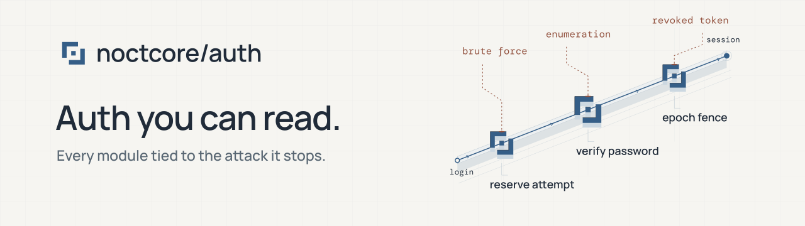

<div align="center">
  <picture>
    <source media="(prefers-color-scheme: dark)" srcset="assets/brand/readme-header-dark.svg">
    <source media="(prefers-color-scheme: light)" srcset="assets/brand/readme-header-light.svg">
    
  </picture>

  <p><strong>Authentication for TypeScript servers in the spirit of Lucia: small modules you can read in an afternoon, each one tied to the attack it stops.</strong></p>

  <p>
    <a href="https://github.com/noctcore/auth/actions/workflows/ci.yml"></a>
    <a href="https://scorecard.dev/viewer/?uri=github.com/noctcore/auth"></a>
    <a href="LICENSE"></a>
    <a href="#status"></a>
    
  </p>

  <p>
    <a href="https://noctcore.github.io/auth/"><strong>Docs</strong></a> (coming soon)
    &nbsp;·&nbsp;
    <a href="examples/basic"><strong>Example app</strong></a>
    &nbsp;·&nbsp;
    <a href="CONTRIBUTING.md"><strong>Contributing</strong></a>
    &nbsp;·&nbsp;
    <a href="SECURITY.md"><strong>Security</strong></a>
  </p>
</div>

<a id="status"></a>

> [!WARNING]
> **Early development.** This library is not ready for production apps yet. The API may
> change in any release before 1.0, and nothing is published to npm so far. Try it, read it,
> open issues, but do not put real users behind it yet.

## What it is

Most auth bugs are not exotic. A reset link that works twice, a session that survives a password
change, a login form that tells an attacker which emails have accounts, a rate limit keyed on an
IP the client chose itself. I wrote this library so that each of those has one small module whose
first comment names the mistake, and whose code you can check against that comment.

The app keeps its own routes. The package ships the logic, the stores and the checks; flows return
results instead of throwing HTTP errors, and plugins add flows (functions), never endpoints.

| Module | The attack or mistake it exists for |
|---|---|
| Sessions | Stolen or forgotten sessions: opaque 32-byte tokens stored only as a SHA-256, idle and absolute expiry, and revocation that a racing login cannot undo (the epoch fence) |
| Passwords | Offline cracking and credential stuffing: Argon2id with rehash on login, a length-only policy (12 to 256), and a k-anonymity breached-password check |
| One-time tokens | Replayed or guessed links and codes: single use, purpose bound, hashed at rest, codes HMACed with an attempt cap enforced before the comparison |
| Throttle | Brute force and lockout abuse: per-door rate limits that fail closed, two lockout budgets, capped exponential backoff with no permanent lock, trusted devices |
| CSRF | Cross-site requests riding the user's cookies: `Sec-Fetch-Site`, an Origin allowlist and a signed double-submit token bound to the session |
| Client IP | Spoofed `X-Forwarded-For`: trust exactly as many proxy hops as you run, counted from the right |
| Captcha | Bots on the login, register and reset doors: a Turnstile verifier that checks hostname and action, and treats an outage as a failure, never a pass |
| Flows | Account enumeration: register, login and the reset request answer the same way whether or not the address has an account |

## Security defaults

Every default is written down in the source with its reason; where published guidance disagrees,
the stricter value wins.

- **Sessions:** 24 h absolute, 30 min idle; with "remember me", 30 d absolute and 7 d idle. At most
  10 per user. Cookies are `Secure`, `HttpOnly`, `SameSite=Lax` and `__Host-` prefixed.
- **Passwords:** Argon2id at 19 MiB, 3 passes, 1 lane. Hashes made with older parameters are
  upgraded after a successful login, with a compare-and-set so a concurrent password change wins.
- **Lockout:** 5 attempts per account and IP and 10 per account in 15 minutes. Locks start at 5
  minutes, triple each time and stop at 1 hour. A new lock mails the owner. A locked account
  answers exactly like a wrong password.
- **Email verification:** 8-digit codes valid for 15 minutes. **Password reset:** single-use links
  valid for 1 hour, or codes exchanged for a short ticket.
- **Fresh auth:** sensitive actions need a credential proof from the last 10 minutes.
- **Registration:** enumeration safe by default. A taken address gets the same answer plus an
  "account exists" mail to its owner.

## Packages

| Package | What it holds |
|---|---|
| [`@noctcore/auth`](packages/auth) | The framework-free core: primitives, sessions, tokens, throttle, flows and plugin seams. `@noctcore/auth/argon2` holds the Argon2id hasher (optional native peer `@node-rs/argon2`); `@noctcore/auth/testing` holds in-memory stores, fakes and the store conformance suite |
| [`@noctcore/auth-redis`](packages/auth-redis) | `SessionStore` and `CounterStore` on ioredis |
| [`@noctcore/auth-prisma`](packages/auth-prisma) | `UserStore` and `TokenStore` on Prisma 7, plus the schema to merge into yours |

Any store that passes the conformance suite in `@noctcore/auth/testing` works, so Redis and Prisma
are a starting point, not a requirement. All packages share one version.

## Quick look

Wire the stores once:

```ts
import { clientIp, createAuth, pwnedPasswords, serializeCookie, toPublicError } from '@noctcore/auth';
import { argon2id } from '@noctcore/auth/argon2';
import { prismaStores } from '@noctcore/auth-prisma';
import { redisStores } from '@noctcore/auth-redis';

const { users, tokens } = prismaStores({ delegate: prisma.user, tokenDelegate: prisma.authToken });
const { sessions, counters } = redisStores(redis, { prefix: 'app:' });

const auth = createAuth({
  stores: { users, tokens, sessions, counters },
  password: { hasher: argon2id(), breachCheck: pwnedPasswords() },
  secret: process.env.AUTH_SECRET!, // 32 bytes or more
  urls: { resetPassword: (token) => `https://app.example/reset-password#${token}` },
  mailer, // sends verification codes, reset links and lock notices
});
```

Then call flows from your own routes:

```ts
const meta = {
  ip: clientIp({ remoteAddress: req.socket.remoteAddress, trustedHops: 0 }) ?? 'unknown',
  userAgent: req.headers['user-agent'] ?? '',
};

const result = await auth.login({
  email: body.email,
  password: body.password,
  deviceToken: auth.readDeviceToken(req.headers.cookie),
  meta,
});

if (!result.ok) {
  // A wrong password, an unknown email and a locked account give the same answer.
  return reply(401, { error: toPublicError(result) });
}

if (result.value.kind === 'session') {
  const { cookie, deviceCookie } = result.value.session;
  setHeader('set-cookie', [cookie, deviceCookie].map(serializeCookie));
}

// On every later request:
const session = await auth.validateRequest({ token: auth.readSessionToken(req.headers.cookie), meta });
```

[`examples/basic`](examples/basic) is a complete JSON API on `node:http` with register, login,
email verification, sessions, logout and CSRF protection, plus an end-to-end test against real
Redis and PostgreSQL.

## Docs

The docs site, with a Learn guide that explains every defense in plain terms, will live at
[noctcore.github.io/auth](https://noctcore.github.io/auth/) (coming soon). Until then, every source
module starts with a comment that says what it defends against, and the package READMEs cover the
adapters.

## Development

```sh
bun install
bun run build
bun run format:check && bun run lint && bun run typecheck
bun run test                 # unit tests on in-memory fakes
bun run services:up          # Redis and Postgres in Docker
bun run test:integration     # conformance on the real backends (reads .env.example values)
```

## Contributing

Issues and pull requests are welcome. Please open an issue first for anything larger than a small
fix, so we can agree on the shape before you write code. [CONTRIBUTING.md](CONTRIBUTING.md) covers
the layout, the checks, the conventions and changesets. Everyone taking part follows the
[Code of Conduct](CODE_OF_CONDUCT.md).

## Security

This is authentication code, so most bugs in it are security bugs. Please do not open a public
issue for a vulnerability; [SECURITY.md](SECURITY.md) explains how to report it privately and what
counts. The [threat model](docs/THREAT_MODEL.md) says what the library defends against and what it
leaves to the app, and [How this library is tested](https://noctcore.github.io/auth/security/testing/)
lists every gate a change has to pass.

## License

[MIT](LICENSE)
